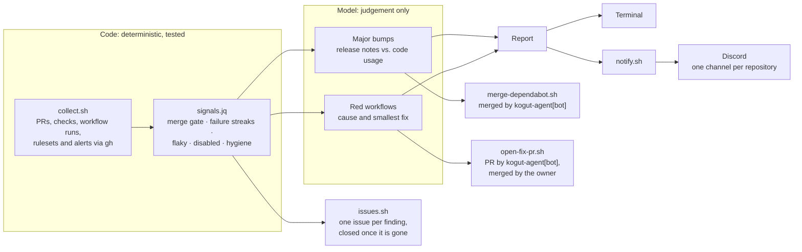

<p align="center">
  
</p>

# kogut · ai-agentic-workflow

[](https://github.com/AKogut/ai-agentic-workflow/actions/workflows/ci.yml)
[](./LICENSE)
[](https://docs.claude.com/en/docs/claude-code/overview)
[](./scripts)
[](./.gitleaks.toml)

**kogut** is an agentic maintainer for my public portfolio repositories, built on [Claude Code](https://docs.claude.com/en/docs/claude-code/overview). It reviews Dependabot pull requests, including the breaking changes that hide behind green CI. It also diagnoses failing workflows, audits repository hygiene, and posts a report for every repository to its own Discord channel.

> **Status:** analysis, Discord reports, guarded Dependabot merges, issues that track every finding, and fix PRs run against six repositories. On GitHub kogut acts under its own identity, `kogut-agent[bot]`, so its work and mine stay apart in the history.

## Why

Six public repositories, 43 workflows and a weekly stream of Dependabot PRs are more upkeep than one person keeps up with by hand. The costly failures are the quiet ones:

- a scheduled workflow that GitHub switched off
- a nightly report that has been red for a week
- a major bump whose CI is green while the code it breaks is not exercised

A bot that merges whatever is green would miss all three. kogut splits the work instead: **code decides everything that needs no judgement, and the model judges only what code can't.**

## What it caught on its first run

| Repository | Finding | Why "CI is green" was not enough |
|---|---|---|
| [flakemetry](https://github.com/AKogut/flakemetry) | OpenTelemetry v3 arrived as four Dependabot PRs, each of them green. v3 removes `@opentelemetry/sdk-trace-base`, which `packages/sdk` imports in three places. | Each PR passes on its own because `sdk-trace-base` stays on 2.x. kogut read the release notes, searched the code and held all four back until a migration lands. |
| [restful-booker-api-testing](https://github.com/AKogut/restful-booker-api-testing) | `main` and the nightly report had been red for a week. | The cause was external: the hosted platform was unreachable, while the same suite passed against the dockerized target. The fix is a change of target, not of code. |
| [mobile-task-manager-automation](https://github.com/AKogut/mobile-task-manager-automation) | The nightly E2E run had quietly stopped. | GitHub disables scheduled workflows after 60 days without activity. A disabled workflow produces no failures, so nothing was red. |

## How it works



1. **Collect.** [`collect.sh`](scripts/collect.sh) reads every watched repository with `gh` in about 25 seconds, without a model: open PRs and their checks, each workflow's run history on the default branch, required checks from branch protection and rulesets, Dependabot alerts and settings.
2. **Apply the policy.** [`signals.jq`](scripts/signals.jq) reduces that state to signals, and the merge gate lives here. A Dependabot PR is ready only when every required check has passed, it is mergeable, it is not behind the default branch and it is at least three days old. A repository without required checks never has a ready PR, because "green" means nothing there. A group PR is rated by every update Dependabot lists in its body, a minor below 1.0 counts as a major, a PR whose versions cannot be read is never ready, and a major that one npm scope takes across several PRs blocks each of them.
3. **Judge.** The model works only where judgement is needed:
   - For a major bump, it reads the release notes and searches the code for what changed.
   - For a red workflow, it reads the failed log ([`failed-log.sh`](scripts/failed-log.sh)) and the code on the default branch ([`repo.sh`](scripts/repo.sh)). It classifies the cause as external, regression, dependency, infra or flaky, and proposes the smallest fix.
4. **Merge.** [`merge-dependabot.sh`](scripts/merge-dependabot.sh) collects the repository again and merges a PR only when the gate says it is ready, pinned to the commit the gate judged. A major needs `--major`, which the model adds after its review. The merge is made by `kogut-agent[bot]`, the script never passes `--admin`, and the owner approves every call.
5. **Track.** [`issues.sh`](scripts/issues.sh) keeps one GitHub issue per finding: a red workflow, a disabled one, critical and high alerts, hygiene gaps, and the majors the model says need me. Each finding carries a stable key from `signals.jq`, so a run updates the issue's facts instead of opening a duplicate, and closes the issue with a comment once the finding is gone. The rules live in [`issues.jq`](scripts/issues.jq) and are tested. The model writes only the diagnosis. The issue list becomes kogut's memory between runs and a public record of what it found and closed.
6. **Fix.** `/kogut fix <repo> <what>` turns a diagnosis into a pull request. [`fix-start.sh`](scripts/fix-start.sh) checks out the default branch in a worktree, and the model makes the smallest change there. [`open-fix-pr.sh`](scripts/open-fix-pr.sh) then scans the change with gitleaks and opens it as a PR from `kogut-agent[bot]`. The owner reviews and merges it on GitHub, and kogut never merges its own fixes. If the PR goes red, or I leave a review, the next run follows up: [`update-fix-pr.sh`](scripts/update-fix-pr.sh) pushes a commit on the same branch, or answers with a comment when no change is needed. Only my reviews count, and after three follow-up commits the PR is mine.
7. **Take tasks.** I hand kogut work by labelling an issue `kogut-task`. `/kogut tasks` takes on maintenance and migrations: it opens a PR that closes the issue, or answers on the issue when the task is out of scope or unclear ([`task-reply.sh`](scripts/task-reply.sh)). Only a label I added counts, which `signals.jq` decides and the script checks again on GitHub. Features stay out of kogut's scope.
8. **Report.** Each repository gets one block: what kogut merged, what needs the owner, CI, hygiene and a TL;DR. The report goes to the terminal and to the repository's Discord channel.

## Security model

kogut reads text written by strangers. Dependabot copies upstream release notes into its PRs verbatim, and CI logs can contain anything. The design assumes that text is hostile.

- **Least privilege.** [`.claude/settings.json`](.claude/settings.json) allows only read-only commands and the kogut scripts. Repository edits, workflow changes and `gh pr merge --admin` are denied. Merges, fix PRs, issue changes, `gh api`, `git push` and `curl` need the owner's approval.
- **Its own identity.** On GitHub kogut acts as a GitHub App, `kogut-agent`. It can write code, pull requests, issues and workflow files in the six watched repositories, and nothing else. It is not on any ruleset's bypass list, so unlike my own token it cannot merge past a red check. A script that acts on GitHub refuses to run without the App's token rather than fall back to mine. The App's private key lives outside the repository with mode 600, and the model is denied from reading it.
- **Policy in code.** The model can hold a PR back but cannot merge past a blocker. The rules are covered by [tests](tests/run.sh).
- **Secrets stay local.** Discord webhooks live in a gitignored `.env` that the model is denied from reading. [`notify.sh`](scripts/notify.sh) accepts only Discord URLs and never prints them. Mentions are disabled, so quoted text cannot ping anyone.
- **Updates are never run locally.** Dependabot branches are never installed on this machine. They run only in GitHub's CI.
- **`main` is protected.** It takes pull requests only, through squash merges. CI must pass first: lint, policy tests, and a gitleaks scan of the full history. Force pushes are blocked. Only the owner can override a red check, and only on a pull request, never with a direct push. Every portfolio repository uses the same ruleset.

The full threat table is in [SECURITY.md](SECURITY.md).

## Discord reports

Each repository gets a report on every run, even when nothing needs doing. A quiet channel then means kogut did not run, not that all is well. An excerpt from a real run:

> **🟡 ai-flaky-test-triage**<br>
> **kogut would merge:** [#210](https://github.com/AKogut/ai-flaky-test-triage/pull/210) (vite 8.3.4 → 8.3.5, patch, checks green)<br>
> **CI:** main is green. Isolated failures in the last 30 runs: CI 1/30, Dependabot Updates 1/30. That is below the threshold, so kogut did not investigate them.<br>
> …

## Design decisions

| Decision | Why |
|---|---|
| Runs locally in Claude Code, on demand | It runs on my Claude subscription and needs no API key or server. Approvals stay interactive. |
| Bash, `gh` and `jq`, no runtime dependencies | The work is API calls and JSON. The scripts stay compatible with the bash 3.2 that ships with macOS. |
| One sweep instead of webhooks | Six repositories don't justify a workflow in each. One pass reads them all. |
| Code is read from `origin`, never the working copy | A working copy may be on any branch with any local edits. |
| Approvals are permission prompts | A sentence in a prompt can be argued with. An `ask` rule in the harness cannot. |
| A GitHub App instead of my token | The history shows what the agent did and what I did. The App holds only the permissions kogut needs and cannot bypass a ruleset. |
| Fix commits built through the API | No git credentials on disk. The script checks that GitHub's tree hashes to the staged one, so the PR holds exactly the diff that was shown. |

## Quick start

```sh
git clone https://github.com/AKogut/ai-agentic-workflow.git && cd ai-agentic-workflow
cp .env.example .env              # one Discord webhook per repository
./scripts/notify.sh --check       # checks every webhook without posting
./scripts/app.sh manifest         # registers the GitHub App kogut acts as
./scripts/app.sh check            # once it is installed: a token for every repository
claude                            # then run /kogut analyze
```

Requires [Claude Code](https://docs.claude.com/en/docs/claude-code/overview), an authenticated [`gh`](https://cli.github.com/), `jq`, `curl`, `openssl` and [`gitleaks`](https://github.com/gitleaks/gitleaks). The watched repositories and the paths of their local clones are listed in [`kogut.config.json`](kogut.config.json), along with the App's id. An App registered by hand is stored with `./scripts/app.sh import <id>`.

| Command | What it does |
|---|---|
| `/kogut` | Analyses every repository, merges what is ready, updates the kogut issues, posts to Discord and prints the report |
| `/kogut flakemetry` | Does the same for one repository |
| `/kogut analyze` | Prints the report in the terminal only |
| `/kogut fix flakemetry <what>` | Opens one fix as a pull request from `kogut-agent[bot]` |
| `/kogut tasks` | Takes on the issues I labelled `kogut-task`: a PR, or an answer on the issue |

To run it from any directory:

```sh
kogut() { (cd ~/GitHubPersonal/ai-agentic-workflow && claude "/kogut $*"); }
```

## Repository layout

```
.claude/skills/kogut/SKILL.md   the procedure /kogut follows: the judgement half
.claude/settings.json           what the model may run, must ask for, never runs
scripts/collect.sh              repository state → .kogut/state.json + signals
scripts/signals.jq              the policy: merge gate, CI health, hygiene
scripts/failed-log.sh           the part of a failed run that explains it
scripts/merge-dependabot.sh     the only way kogut merges: re-checks the gate, never --admin
scripts/issues.sh               one issue per finding: opened, updated, closed by the App
scripts/issues.jq               the issue policy: when to open, update, keep, skip or close
scripts/fix-start.sh            a worktree at origin's default branch for one fix
scripts/open-fix-pr.sh          the only way kogut opens a PR: gitleaks, then the App's commit
scripts/update-fix-pr.sh        a follow-up commit or an answer on kogut's own PR, within a limit
scripts/pr-feedback.sh          the owner's reviews on a kogut PR; nobody else's words
scripts/task-reply.sh           kogut's answer on a task it cannot start yet
scripts/app.sh                  registers the GitHub App and checks its installation
scripts/repo.sh                 grep / show / log on origin's default branch
scripts/notify.sh               Discord delivery: mentions off, URLs never printed
tests/run.sh                    policy tests against a fixed snapshot
kogut.config.json               watched repositories and policy numbers
```

## Development

```sh
git config core.hooksPath .githooks   # gitleaks scans every commit
./tests/run.sh                        # 61 policy checks
shellcheck scripts/*.sh tests/*.sh
```

See [CONTRIBUTING.md](CONTRIBUTING.md) for the ground rules.

## Roadmap

- [x] **Analysis:** `/kogut analyze`, a read-only report
- [x] **Discord:** a channel per repository
- [ ] **Hygiene baseline:** required checks, auto-merge, Dependabot config and alerts in every watched repository
- [x] **Merging:** Dependabot PRs merged through a script that re-checks the policy itself
- [x] **Fixes:** prepared in a worktree and opened as a PR by `kogut-agent[bot]` after the owner approves
- [x] **Identity:** a GitHub App, so the agent's work and mine stay apart in the history
- [x] **Issues:** one issue per finding, updated every run and closed once the finding is gone
- [x] **Follow-up:** kogut takes its own PRs to green and answers review comments
- [x] **Tasks:** issues the owner labels `kogut-task` become PRs, within maintenance and migrations
- [ ] **Lockfile fixes:** `overrides` for transitive alerts that Dependabot cannot fix

## License

[MIT](LICENSE) © Andrii Kohut
