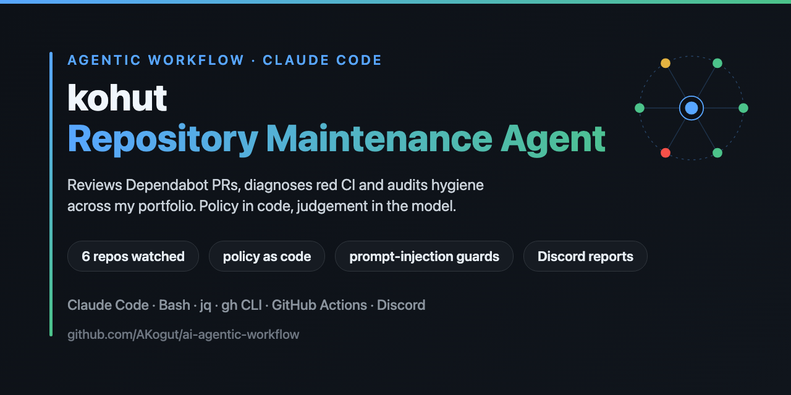
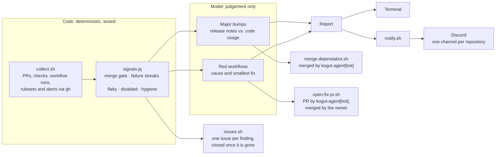

<p align="center">
  
</p>

# kogut · ai-agentic-workflow

[](https://github.com/AKogut/ai-agentic-workflow/actions/workflows/ci.yml)
[](./LICENSE)
[](https://docs.claude.com/en/docs/claude-code/overview)
[](./scripts)
[](./.gitleaks.toml)

**kogut** is an agentic maintainer for my public portfolio repositories, built on [Claude Code](https://docs.claude.com/en/docs/claude-code/overview). It reviews Dependabot pull requests, including the breaking changes that hide behind green CI. It also diagnoses failing workflows, audits repository hygiene, and posts a report for every repository to its own Discord channel.

> **Status:** analysis, Discord reports, guarded Dependabot merges, issues that track every finding, and fix PRs run against six repositories. On GitHub kogut acts under its own identity, `kogut-agent[bot]`, so its work and mine stay apart in the history.

## Why

Six public repositories, 43 workflows and a weekly stream of Dependabot PRs are more upkeep than one person keeps up with by hand. The costly failures are the quiet ones:

- a scheduled workflow that GitHub switched off
- a nightly report that has been red for a week
- a major bump whose CI is green while the code it breaks is not exercised

A bot that merges whatever is green would miss all three. kogut splits the work instead: **code decides everything that needs no judgement, and the model judges only what code can't.**

## What it caught on its first run

| Repository | Finding | Why "CI is green" was not enough |
|---|---|---|
| [flakemetry](https://github.com/AKogut/flakemetry) | OpenTelemetry v3 arrived as four Dependabot PRs, each of them green. v3 removes `@opentelemetry/sdk-trace-base`, which `packages/sdk` imports in three places. | Each PR passes on its own because `sdk-trace-base` stays on 2.x. kogut read the release notes, searched the code and held all four back until a migration lands. |
| [restful-booker-api-testing](https://github.com/AKogut/restful-booker-api-testing) | `main` and the nightly report had been red for a week. | The cause was external: the hosted platform was unreachable, while the same suite passed against the dockerized target. The fix is a change of target, not of code. |
| [mobile-task-manager-automation](https://github.com/AKogut/mobile-task-manager-automation) | The nightly E2E run had quietly stopped. | GitHub disables scheduled workflows after 60 days without activity. A disabled workflow produces no failures, so nothing was red. |

## How it works



1. **Collect.** [`collect.sh`](scripts/collect.sh) reads every watched repository with `gh` in about 25 seconds, without a model: open PRs and their checks, each workflow's run history on the default branch, required checks from branch protection and rulesets, Dependabot alerts and settings.
2. **Apply the policy.** [`signals.jq`](scripts/signals.jq) reduces that state to signals, and the merge gate lives here. A Dependabot PR is ready only when every required check has passed, it is mergeable, it is not behind the default branch and it is at least three days old. The cooldown is skipped for a PR that fixes a critical or high alert: one of its updates takes the package in the alert's directory out of the vulnerable range. A repository without required checks never has a ready PR, because "green" means nothing there. A group PR is rated by every update Dependabot lists in its body, a minor below 1.0 counts as a major, a PR whose versions cannot be read is never ready, and a major that one npm scope takes across several PRs blocks each of them.
3. **Judge.** The model works only where judgement is needed:
   - For a major bump, it reads the release notes and searches the code for what changed.
   - For a red workflow, it reads the failed log ([`failed-log.sh`](scripts/failed-log.sh)) and the code on the default branch ([`repo.sh`](scripts/repo.sh)). It classifies the cause as external, regression, dependency, infra or flaky, and proposes the smallest fix.
4. **Merge.** [`merge-dependabot.sh`](scripts/merge-dependabot.sh) collects the repository again and merges a PR only when the gate says it is ready, pinned to the commit the gate judged. Patches to direct dev dependencies past the cooldown merge on their own through [`auto-merge.sh`](scripts/auto-merge.sh), once a day, and nothing else does. One call can name several PRs of a repository, so I approve them together, and each is still judged on its own. A major needs `--major`, which the model adds after its review, in a call of its own. The merge is made by `kogut-agent[bot]`, the script never passes `--admin`, and the owner approves every call. A Dependabot PR that is stuck (behind, in conflict for a day, or red on an older base) gets `@dependabot rebase` or `recreate` from [`dependabot-command.sh`](scripts/dependabot-command.sh), once per head commit, and only where the rules in `signals.jq` name that command. That comment goes out under my login, because Dependabot refuses commands from an App. A red workflow on the default branch gets one retry of its failed jobs, or a run at the current head when its last result is stale, and a workflow GitHub disabled for inactivity is turned back on, through [`run-workflow.sh`](scripts/run-workflow.sh). The same script runs a workflow on the branch of a Dependabot or kogut PR, for a check the PR does not get, such as an E2E suite that runs only by hand.
5. **Track.** [`issues.sh`](scripts/issues.sh) keeps one GitHub issue per finding: a red workflow, a disabled one, critical and high alerts, hygiene gaps, and the majors the model says need me. Each finding carries a stable key from `signals.jq`, so a run updates the issue's facts instead of opening a duplicate, and closes the issue with a comment once the finding is gone. The rules live in [`issues.jq`](scripts/issues.jq) and are tested. The model writes only the diagnosis. The issue list becomes kogut's memory between runs and a public record of what it found and closed.
6. **Fix.** `/kogut fix <repo> <what>` turns a diagnosis into a pull request. [`fix-start.sh`](scripts/fix-start.sh) checks out the default branch in a worktree, and the model makes the smallest change there. When the change touches a manifest, for example an `overrides` entry for a transitive alert that Dependabot cannot move, [`fix-lockfile.sh`](scripts/fix-lockfile.sh) regenerates the lockfile with npm or pnpm in lockfile-only mode, with scripts off, and shows which locked versions changed. [`open-fix-pr.sh`](scripts/open-fix-pr.sh) then scans the change with gitleaks and opens it as a PR from `kogut-agent[bot]`. The owner reviews and merges it on GitHub, and kogut never merges its own fixes. If the PR goes red, or I leave a review, the next run follows up: [`update-fix-pr.sh`](scripts/update-fix-pr.sh) pushes a commit on the same branch, or answers with a comment when no change is needed. Only my reviews count, and after three follow-up commits the PR is mine.
7. **Take tasks.** I hand kogut work by labelling an issue `kogut-task`. `/kogut tasks` takes on maintenance and migrations: it opens a PR that closes the issue, or answers on the issue when the task is out of scope or unclear ([`task-reply.sh`](scripts/task-reply.sh)). Only a label I added counts, which `signals.jq` decides and the script checks again on GitHub. kogut also takes on two kinds of its own issues without a label: critical and high alerts that no open Dependabot PR fixes, by the same rule that lets a fix skip the cooldown, and a major that needs a migration. I still approve each PR and merge it. Features stay out of kogut's scope.
8. **Report.** Each repository gets one block: what kogut merged, what needs the owner, CI, hygiene and a TL;DR. The report goes to the terminal and to the repository's Discord channel.

## Security model

kogut reads text written by strangers. Dependabot copies upstream release notes into its PRs verbatim, and CI logs can contain anything. The design assumes that text is hostile.

- **Least privilege.** [`.claude/settings.json`](.claude/settings.json) allows only read-only commands and the kogut scripts. Repository edits, workflow changes and `gh pr merge --admin` are denied. Merges, fix PRs, issue changes and `git push` need the owner's approval, as do a `gh api` call that writes (a method, fields, an input file or GraphQL) and a `curl` that sends, uploads or saves data. Read-only `gh api` calls and `curl -s` reads from the npm and RubyGems registries run without asking.
- **Its own identity.** On GitHub kogut acts as a GitHub App, `kogut-agent`. It can write code, pull requests, issues and workflow files, and run workflows, in the six watched repositories, and nothing else. It is not on any ruleset's bypass list, so unlike my own token it cannot merge past a red check. A script that acts on GitHub refuses to run without the App's token rather than fall back to mine. The App's private key lives outside the repository with mode 600, and the model is denied from reading it.
- **Policy in code.** The model can hold a PR back but cannot merge past a blocker. The rules are covered by [tests](tests/run.sh).
- **Secrets stay local.** Discord webhooks live in a gitignored `.env` that the model is denied from reading. [`notify.sh`](scripts/notify.sh) accepts only Discord URLs and never prints them. Mentions are disabled, so quoted text cannot ping anyone.
- **Updates are never run locally.** Dependabot branches are never installed on this machine. They run only in GitHub's CI. A fix that changes a manifest gets its lockfile regenerated in lockfile-only mode: no `node_modules`, no lifecycle scripts, no pnpmfile hooks, so no package code runs here.
- **`main` is protected.** It takes pull requests only, through squash merges. CI must pass first: lint, policy tests, and a gitleaks scan of the full history. Force pushes are blocked. Only the owner can override a red check, and only on a pull request, never with a direct push. Every portfolio repository uses the same ruleset.

The full threat table is in [SECURITY.md](SECURITY.md).

## Discord reports

Each repository gets a report on every run, even when nothing needs doing. A quiet channel then means kogut did not run, not that all is well. An excerpt from a real run:

> **🟡 ai-flaky-test-triage**<br>
> **kogut would merge:** [#210](https://github.com/AKogut/ai-flaky-test-triage/pull/210) (vite 8.3.4 → 8.3.5, patch, checks green)<br>
> **CI:** main is green. Isolated failures in the last 30 runs: CI 1/30, Dependabot Updates 1/30. That is below the threshold, so kogut did not investigate them.<br>
> …

## Design decisions

| Decision | Why |
|---|---|
| Runs locally in Claude Code, on demand | It runs on my Claude subscription and needs no API key or server. Approvals stay interactive. |
| Secrets go by age, and only by age | GitHub gives a secret's name and date, never its value or expiry. A token that runs out shows up only when a release fails, as flakemetry's did at 98 days. kogut warns at 80 days, says the secret may have expired, and leaves rotating it to me. |
| A failed read never closes a Node runtime issue | Without the release schedule or the repository's files, kogut cannot tell whether the finding is gone, so it flags nothing and keeps the issue. |
| Logs are read for a name, never carried | A log is untrusted text, so `run-cause.sh` reduces it to a signature's name from a table of real failures, and nothing else reaches the snapshot, a report or an issue. A forged signature can cost one retry at most. |
| Unattended merges for one narrow tier | Five `@types/node` patches should not wait for me to come back at a given hour. A launchd job with no model merges patches to direct dev dependencies past the cooldown, when the title and Dependabot's own commit metadata both say so and the default branch is green. I gave up reviewing those, knowingly: a bad patch that outlasts the cooldown and passes CI lands without anyone looking. Everything else still asks. |
| Features need a plan I approved | kogut started as maintenance only. A feature takes judgement, so it goes through its own lane: a plan on the issue, code only after my label, and a draft PR that CI alone has run. It stays small enough to review, and I merge it. |
| A stop switch in code, not in a note | When I work in a repository, kogut stays out. `hold.sh` makes every writing script refuse it, and a damaged switch holds everything rather than nothing. |
| A daily digest without the model | kogut only works when it is started, so a draft whose hold date had passed sat unnoticed for six days. A launchd job posts each repository's state every morning with `jq`, spending no tokens and changing nothing on GitHub. Everything that acts stays in `/kogut`. |
| Bash, `gh` and `jq`, no runtime dependencies | The work is API calls and JSON. The scripts stay compatible with the bash 3.2 that ships with macOS. |
| One sweep instead of webhooks | Six repositories don't justify a workflow in each. One pass reads them all. |
| Code is read from `origin`, never the working copy | A working copy may be on any branch with any local edits. |
| Approvals are permission prompts | A sentence in a prompt can be argued with. An `ask` rule in the harness cannot. |
| A GitHub App instead of my token | The history shows what the agent did and what I did. The App holds only the permissions kogut needs and cannot bypass a ruleset. |
| Fix commits built through the API | No git credentials on disk. The script checks that GitHub's tree hashes to the staged one, so the PR holds exactly the diff that was shown. |

## Quick start

```sh
git clone https://github.com/AKogut/ai-agentic-workflow.git && cd ai-agentic-workflow
cp .env.example .env              # one Discord webhook per repository
./scripts/notify.sh --check       # checks every webhook without posting
./scripts/app.sh manifest         # registers the GitHub App kogut acts as
./scripts/app.sh check            # once it is installed: a token for every repository
claude                            # then run /kogut analyze
```

Requires [Claude Code](https://docs.claude.com/en/docs/claude-code/overview), an authenticated [`gh`](https://cli.github.com/), `jq`, `curl`, `openssl` and [`gitleaks`](https://github.com/gitleaks/gitleaks), plus `npm` and the `pnpm` version a repository's `packageManager` names, for lockfile fixes. The watched repositories and the paths of their local clones are listed in [`kogut.config.json`](kogut.config.json), along with the App's id. An App registered by hand is stored with `./scripts/app.sh import <id>`.

| Command | What it does |
|---|---|
| `/kogut` | Analyses every repository, merges what is ready, updates the kogut issues, posts to Discord and prints the report |
| `/kogut flakemetry` | Does the same for one repository |
| `/kogut analyze` | Prints the report in the terminal only |
| `/kogut fix flakemetry <what>` | Opens one fix as a pull request from `kogut-agent[bot]` |
| `/kogut tasks` | Takes on the issues I labelled `kogut-task`: a PR, or an answer on the issue |
| `/kogut progress` | Reports what kogut did in the last 7 days next to what I did (`--days N` or `--since YYYY-MM-DD` for another window) |

To run it from any directory:

```sh
kogut() { (cd ~/GitHubPersonal/ai-agentic-workflow && claude "/kogut $*"); }
```

## Repository layout

```
.claude/skills/kogut/SKILL.md   the procedure /kogut follows: the judgement half
.claude/settings.json           what the model may run, must ask for, never runs
scripts/collect.sh              repository state → .kogut/state.json + signals
scripts/signals.jq              the policy: merge gate, CI health, hygiene
scripts/failed-log.sh           the part of a failed run that explains it
scripts/run-cause.sh            why a failed run failed: a kind and a signature's name, never its text
scripts/causes.jq               the signatures, each taken from a real failure
scripts/merge-dependabot.sh     the only way kogut merges: re-checks the gate per PR, never --admin
scripts/dependabot-command.sh   @dependabot rebase or recreate, only where the rules name it
scripts/run-workflow.sh         rerun, dispatch or enable a workflow as the rules name it, or run one on a PR's branch
scripts/dismiss-alert.sh        dismisses one package's alerts with a recorded reason, when I ask for it
scripts/dismiss.jq              what may be dismissed: never a critical alert, never one a PR is fixing
scripts/prune-branches.sh       deletes named branches the rules call merged; prints how to restore them
scripts/progress.sh             what kogut did over a window, next to the owner; read-only
scripts/progress.jq             the counting and the markdown behind /kogut progress
scripts/issues.sh               one issue per finding: opened, updated, closed by the App
scripts/issues.jq               the issue policy: when to open, update, keep, skip or close
scripts/fix-start.sh            a worktree at origin's default branch for one fix
scripts/open-fix-pr.sh          the only way kogut opens a PR: gitleaks, then the App's commit
scripts/update-fix-pr.sh        a follow-up commit or an answer on kogut's own PR, within a limit
scripts/fix-lockfile.sh         lockfile-only npm or pnpm in a fix's worktree, with a version summary
scripts/pr-feedback.sh          the owner's reviews on a kogut PR; nobody else's words
scripts/task-reply.sh           kogut's answer on a task it cannot start yet, or its plan for a feature
scripts/task-plan.sh            what to start now, and what waits and why
scripts/task-plan.jq            one piece of work per repository, and a limit on how many at once
scripts/feature.jq              where a feature request stands: plan, waiting for me, or approved
scripts/app.sh                  registers the GitHub App and checks its installation
scripts/repo.sh                 grep / show / log on origin's default branch
scripts/notify.sh               Discord delivery: mentions off, URLs never printed
scripts/digest.sh               the daily digest: collect, render, post; no model, read-only on GitHub
scripts/digest.jq               renders the digest, and sets each report's colour
scripts/digest-schedule.sh      puts the daily job on launchd, or takes it off
scripts/daily.sh                the daily job: auto-merge, then the digest
scripts/auto-merge.sh           merges one narrow tier with nobody watching; no model
scripts/hold.sh                 the stop switch: a repository on hold gets no writes
tests/run.sh                    policy tests against a fixed snapshot
kogut.config.json               watched repositories and policy numbers
```

## Development

```sh
git config core.hooksPath .githooks   # gitleaks scans every commit
./tests/run.sh                        # 66 policy checks
shellcheck scripts/*.sh tests/*.sh
```

See [CONTRIBUTING.md](CONTRIBUTING.md) for the ground rules.

## Roadmap

- [x] **Analysis:** `/kogut analyze`, a read-only report
- [x] **Discord:** a channel per repository
- [x] **Hygiene baseline:** required checks, auto-merge, Dependabot config and alerts in every watched repository
- [x] **Merging:** Dependabot PRs merged through a script that re-checks the policy itself
- [x] **Fixes:** prepared in a worktree and opened as a PR by `kogut-agent[bot]` after the owner approves
- [x] **Identity:** a GitHub App, so the agent's work and mine stay apart in the history
- [x] **Issues:** one issue per finding, updated every run and closed once the finding is gone
- [x] **Follow-up:** kogut takes its own PRs to green and answers review comments
- [x] **Tasks:** issues the owner labels `kogut-task` become PRs, within maintenance and migrations
- [x] **Parallel work:** several tasks at once, one per repository, and I approve the PRs together
- [x] **Features:** an issue I label gets a plan first, code only after I approve it, CI as the only runner, and I merge
- [x] **Lockfile fixes:** `overrides` for transitive alerts that Dependabot cannot fix, with the lockfile regenerated in lockfile-only mode
- [x] **Security fixes first:** a Dependabot PR that fixes a critical or high alert skips the cooldown
- [x] **Dependabot commands:** stuck Dependabot PRs get `@dependabot rebase` or `recreate`, under my login, because Dependabot refuses an App
- [x] **Progress:** `/kogut progress`, what kogut did over a window next to what I did
- [x] **Workflow runs:** a retry, a run at the current head, a workflow turned back on, or a run on a PR's branch, by `kogut-agent[bot]`
- [x] **Daily digest:** each repository's state in its channel every morning, without the model
- [x] **Node runtime:** each repository's Node pin checked against Node's release schedule and its own `engines`
- [x] **Alert dismissals:** one package's alerts dismissed with a recorded reason, only when I ask, and never a critical one
- [x] **Old secrets:** an Actions secret old enough that it may have expired gets an issue, from its name and date alone
- [x] **Causes of a red workflow:** known failures recognised in code, so infrastructure can be retried past the streak and a refused token never is
- [x] **Pruning branches:** a branch goes only when its tip is exactly the head of a PR merged into the default branch, by `kogut-agent[bot]`, and only the ones I name in the approval
- [x] **Hold:** a stop switch per repository, in code, that fails closed
- [x] **Unattended merges:** patches to direct dev dependencies past the cooldown, without me and without the model

## License

[MIT](LICENSE) © Andrii Kohut
