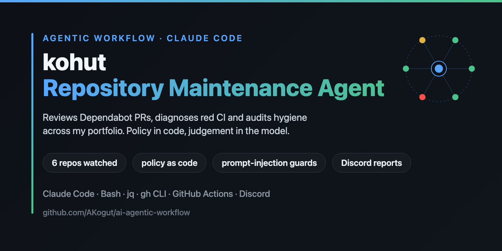
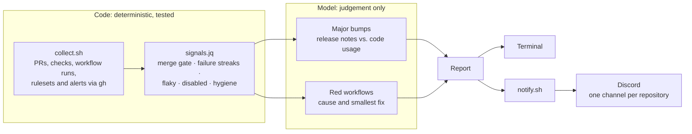

<p align="center">
  
</p>

# kohut · ai-agentic-workflow

[](https://github.com/AKogut/ai-agentic-workflow/actions/workflows/ci.yml)
[](./LICENSE)
[](https://docs.claude.com/en/docs/claude-code/overview)
[](./scripts)
[](./.gitleaks.toml)

**kohut** is an agentic maintainer for my public portfolio repositories, built on [Claude Code](https://docs.claude.com/en/docs/claude-code/overview). It reviews Dependabot pull requests, including the breaking changes that hide behind green CI. It also diagnoses failing workflows, audits repository hygiene, and posts a report for every repository to its own Discord channel.

> **Status:** analysis and Discord reports run against six repositories. Next on the [roadmap](#roadmap) are merging Dependabot PRs through a guarded script and fixes opened only after approval.

## Why

Six public repositories, 43 workflows and a weekly stream of Dependabot PRs are more upkeep than one person keeps up with by hand. The costly failures are the quiet ones:

- a scheduled workflow that GitHub switched off
- a nightly report that has been red for a week
- a major bump whose CI is green while the code it breaks is not exercised

A bot that merges whatever is green would miss all three. kohut splits the work instead: **code decides everything that needs no judgement, and the model judges only what code can't.**

## What it caught on its first run

| Repository | Finding | Why "CI is green" was not enough |
|---|---|---|
| [flakemetry](https://github.com/AKogut/flakemetry) | OpenTelemetry v3 arrived as four Dependabot PRs, each of them green. v3 removes `@opentelemetry/sdk-trace-base`, which `packages/sdk` imports in three places. | Each PR passes on its own because `sdk-trace-base` stays on 2.x. kohut read the release notes, searched the code and held all four back until a migration lands. |
| [restful-booker-api-testing](https://github.com/AKogut/restful-booker-api-testing) | `main` and the nightly report had been red for a week. | The cause was external: the hosted platform was unreachable, while the same suite passed against the dockerized target. The fix is a change of target, not of code. |
| [mobile-task-manager-automation](https://github.com/AKogut/mobile-task-manager-automation) | The nightly E2E run had quietly stopped. | GitHub disables scheduled workflows after 60 days without activity. A disabled workflow produces no failures, so nothing was red. |

## How it works



1. **Collect.** [`collect.sh`](scripts/collect.sh) reads every watched repository with `gh` in about 25 seconds, without a model: open PRs and their checks, each workflow's run history on the default branch, required checks from branch protection and rulesets, Dependabot alerts and settings.
2. **Apply the policy.** [`signals.jq`](scripts/signals.jq) reduces that state to signals, and the merge gate lives here. A Dependabot PR is ready only when every required check has passed, it is mergeable and it is at least three days old. A repository without required checks never has a ready PR, because "green" means nothing there.
3. **Judge.** The model works only where judgement is needed:
   - For a major bump, it reads the release notes and searches the code for what changed.
   - For a red workflow, it reads the failed log ([`failed-log.sh`](scripts/failed-log.sh)) and the code on the default branch ([`repo.sh`](scripts/repo.sh)). It classifies the cause as external, regression, dependency, infra or flaky, and proposes the smallest fix.
4. **Report.** Each repository gets one block: what kohut would do, what needs the owner, CI, hygiene and a TL;DR. The report goes to the terminal and to the repository's Discord channel.

## Security model

kohut reads text written by strangers. Dependabot copies upstream release notes into its PRs verbatim, and CI logs can contain anything. The design assumes that text is hostile.

- **Least privilege.** [`.claude/settings.json`](.claude/settings.json) allows only read-only commands and the kohut scripts. Repository edits and workflow changes are denied. Merges, `gh api`, `git push` and `curl` need the owner's approval.
- **Policy in code.** The model can hold a PR back but cannot merge past a blocker. The rules are covered by [tests](tests/run.sh).
- **Secrets stay local.** Discord webhooks live in a gitignored `.env` that the model is denied from reading. [`notify.sh`](scripts/notify.sh) accepts only Discord URLs and never prints them. Mentions are disabled, so quoted text cannot ping anyone.
- **Updates are never run locally.** Dependabot branches are never installed on this machine. They run only in GitHub's CI.
- **`main` is protected.** It takes pull requests only, through squash merges. CI must pass first: lint, policy tests, and a gitleaks scan of the full history. Force pushes are blocked. Only the owner can override a red check, and only on a pull request, never with a direct push. Every portfolio repository uses the same ruleset.

The full threat table is in [SECURITY.md](SECURITY.md).

## Discord reports

Each repository gets a report on every run, even when nothing needs doing. A quiet channel then means kohut did not run, not that all is well. An excerpt from a real run (reports are written in Ukrainian, my working language):

> **🟡 ai-flaky-test-triage**<br>
> **Kohut змерджив би:** [#210](https://github.com/AKogut/ai-flaky-test-triage/pull/210) (vite 8.3.4 → 8.3.5, patch, перевірки зелені)<br>
> **CI:** main зелений. Поодинокі збої за 30 запусків: CI 1/30, Dependabot Updates 1/30. Це нижче порогу, тож kohut їх не розслідував.<br>
> …

## Design decisions

| Decision | Why |
|---|---|
| Runs locally in Claude Code, on demand | It runs on my Claude subscription and needs no API key or server. Approvals stay interactive. |
| Bash, `gh` and `jq`, no runtime dependencies | The work is API calls and JSON. The scripts stay compatible with the bash 3.2 that ships with macOS. |
| One sweep instead of webhooks | Six repositories don't justify a workflow in each. One pass reads them all. |
| Code is read from `origin`, never the working copy | A working copy may be on any branch with any local edits. |
| Approvals are permission prompts | A sentence in a prompt can be argued with. An `ask` rule in the harness cannot. |

## Quick start

```sh
git clone https://github.com/AKogut/ai-agentic-workflow.git && cd ai-agentic-workflow
cp .env.example .env              # one Discord webhook per repository
./scripts/notify.sh --check       # checks every webhook without posting
claude                            # then run /kohut analyze
```

Requires [Claude Code](https://docs.claude.com/en/docs/claude-code/overview), an authenticated [`gh`](https://cli.github.com/), `jq` and `curl`. The watched repositories and the paths of their local clones are listed in [`kohut.config.json`](kohut.config.json).

| Command | What it does |
|---|---|
| `/kohut` | Analyses every repository, posts to Discord and prints the report |
| `/kohut flakemetry` | Does the same for one repository |
| `/kohut analyze` | Prints the report in the terminal only |

To run it from any directory:

```sh
kohut() { (cd ~/GitHubPersonal/ai-agentic-workflow && claude "/kohut $*"); }
```

## Repository layout

```
.claude/skills/kohut/SKILL.md   the procedure /kohut follows: the judgement half
.claude/settings.json           what the model may run, must ask for, never runs
scripts/collect.sh              repository state → .kohut/state.json + signals
scripts/signals.jq              the policy: merge gate, CI health, hygiene
scripts/failed-log.sh           the part of a failed run that explains it
scripts/repo.sh                 grep / show / log on origin's default branch
scripts/notify.sh               Discord delivery: mentions off, URLs never printed
tests/run.sh                    policy tests against a fixed snapshot
kohut.config.json               watched repositories and policy numbers
```

## Development

```sh
git config core.hooksPath .githooks   # gitleaks scans every commit
./tests/run.sh                        # 23 policy checks
shellcheck scripts/*.sh tests/*.sh
```

See [CONTRIBUTING.md](CONTRIBUTING.md) for the ground rules.

## Roadmap

- [x] **Analysis:** `/kohut analyze`, a read-only report
- [x] **Discord:** a channel per repository
- [ ] **Hygiene baseline:** required checks, auto-merge, Dependabot config and alerts in every watched repository
- [ ] **Merging:** Dependabot PRs merged through a script that re-checks the policy itself
- [ ] **Fixes:** prepared in a worktree and opened as a PR after the owner approves

## License

[MIT](LICENSE) © Andrii Kohut
